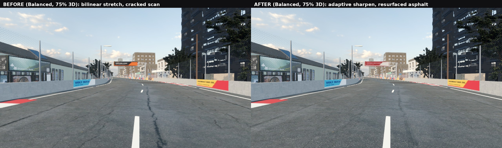
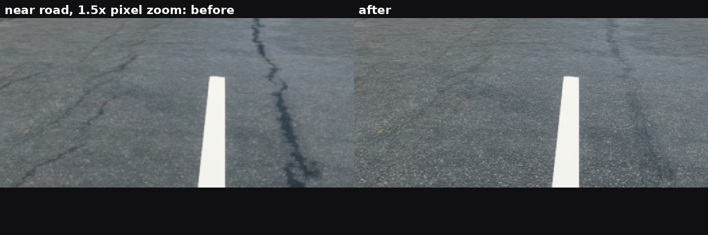

# Image clarity audit 2: genuinely better filtered, or merely softer?

The first clarity pass (`../clarity/`) scored renders by "grain" (Laplacian energy) and "shimmer". Both numbers
fall when an image is blurred, so they could not tell clean filtering from lost detail. This audit measures
against a **reference** instead.

## Method

- **Reference.** The same camera position (Lusaka straight, d = 1000 m, camera 1.3 m up) rendered at 2560x1440,
  with full 3D resolution, MSAA 4x, 8x anisotropic filtering and no mip bias. It is then Lanczos-downsampled to
  1280x720. This gives a properly filtered picture of what the scene really contains.
- **Variants.** Each variant is rendered at 1280x720 with the real Balanced preset. Two views are rendered 5 cm
  apart, and `clarity_ref.py` reports:
  - **error:** mean absolute difference from the reference.
  - **detail:** fine-detail energy relative to the reference. Below 1 means blurred; above 1 means aliasing,
    grain or halos.
  - **edges:** strength of the reference's strongest edges (markings, kerbs, outlines).
  - **shimmer:** change in fine detail over the 5 cm move. A value below the reference's own is a sign of blur,
    not of stability.
- **Renderer.** The Mobile renderer on lavapipe (CPU Vulkan) under xvfb. This shows image content, not phone
  performance.

Reproduce:

```
render.sh <tag> <WxH> [game args]
python3 clarity_ref.py . [--ref ref2] <tags>
```

## Audit findings

| Item | Finding |
|---|---|
| Render scale | Performance renders 3D at 60 %, Balanced at 75 % and Quality at 90 %. On the Mobile renderer Godot 4.7 upscales **bilinearly**: it warns *"FSR1 3D scaling is only available when using the Forward+ renderer"*. Measured: Balanced kept **43 %** of the reference's near-road detail and **69 %** of its edge strength. At 100 % 3D resolution the same scene keeps 85 % and 87 %. **This was the largest single cause of softness.** |
| Road shader | `detail_soften` blended 45 % toward a coarse mip **everywhere**, including the near road, where the scan is fully resolved: blur, not filtering. |
| Asphalt scan | Poly Haven `asphalt_02` is an old street surface with long, wide cracks. The shader's crack fade compared each pixel only with a 16-texel neighbourhood, so the wide cracks survived as the black lines in the screenshots. |
| Mip bias | +0.5 (Performance) and +0.25 (Balanced); never negative. Kept: a negative bias brought shimmer back at speed. |
| Anisotropic filtering | 2x / 4x / 8x / 8x by preset. Kept. |
| Anti-aliasing | Balanced: FXAA. Quality: MSAA 2x. Ultra: MSAA 4x. TAA and FSR 2 do not exist on the Mobile renderer. |
| Post effects | Glow at threshold 0.95. No film grain, chromatic aberration, vignette or motion-blur shader in the race scene. SSAO, SSR and volumetric fog run only on Ultra (Forward+). The first audit measured post-processing as **not** a grain source. |

## Fixes

1. **Adaptive sharpening after the bilinear upscale** (`scripts/core/upscale_sharpen.gdshader`).
   - One 5-tap full-screen pass at native resolution, active only when 3D resolution is below 100 % on Mobile or
     Compatibility.
   - Contrast-adaptive (the RCAS / CAS principle): the sharpening weight is limited by local min/max headroom, so
     there are no halos and no clipping.
   - Strength follows how far the image was scaled: 0.375 at 75 %, 0.51 at 60 %.
   - The first strength tried (0.55 at 75 %) over-sharpened the far road: detail 1.08 and shimmer above the
     reference. It was lowered.
2. **Resurfaced asphalt** (`tools/assets/resurface_asphalt.py`).
   - The cracks are found at low frequency (after a 2.5 px blur, the pores vanish and the cracks remain) and
     lifted to the surrounding tone in albedo, height, normal and roughness.
   - Aggregate grain is kept: the fill is additive, not a smooth patch. 10 % of each crack is kept.
   - No GPU cost.
3. **Footprint-aware road softening.** Detail is softened only where the texture is minified (more than 1.2–4
   texels per pixel: far away, grazing angles). The near road keeps its real aggregate.
4. **Normal map** flattened by a fixed 60 % on every road, so there's no pixel-scale sparkle in the sun.
   Lusaka's shader crack fade drops from 0.85 to 0.3, since the cracks are now gone at the source.

## Results

Absolute fine-detail energy (mean |image − blur|, higher = more detail):

| Region | Reference (old road) | Before (Balanced) | After (Balanced) | Reference (new road) |
|---|---|---|---|---|
| Near road | 3.73 | **1.61** | **3.35** | 5.48 |
| Far road | 2.50 | 1.37 | 2.26 | 2.28 |
| Buildings | 4.47 | 2.28 | 3.07 | 4.45 |

Against each variant's own reference:

| Variant | Near-road detail | Near-road edges | Far-road detail | Building detail | Near-road shimmer (reference) |
|---|---|---|---|---|---|
| Before, 75 % bilinear | 0.43 | 0.69 | 0.55 | 0.51 | 4.11 (7.20) |
| Sharpen at 0.55 (rejected) | 0.95 | 0.88 | **1.08** (over) | 0.73 | 7.12 (7.20) |
| 100 % 3D, old road | 0.85 | 0.87 | 0.98 | 0.85 | 6.01 (7.20) |
| **After, 75 % + sharpen 0.375, new road** | 0.61* | 0.68* | 0.99 | 0.69 | 6.80 (10.39) |
| After, 100 % 3D, new road | 0.70* | 0.79* | 0.99 | 0.85 | 7.18 (10.39) |

\* The new reference is a harder target. With the near road no longer blurred and the cracks gone, the true image
has 47 % more near-road detail (5.48 vs 3.73). In absolute terms the near road went from 1.61 to 3.35, roughly
double the real detail of before. Far-road detail now matches the reference (0.99), and shimmer remains below the
reference's own value.




## Not done here, and why

- **Phone cost.** The sharpening pass is one full-screen 5-tap pass, cheaper than raising the render scale. Its
  actual cost on a phone has not been measured. The in-game benchmark (Settings > Display > Run benchmark) now
  reports CPU render, GPU, physics and logic milliseconds per frame. Running it with 3D resolution at 75 % and
  100 % on a real low-end phone will settle whether Balanced should simply render at a higher scale.
- **Exposure and depth.** Measured on the straight: sky mean 164, buildings 146, road 115 (0–255), with 0.08 %
  clipped highlights and 0.19 % crushed blacks. Nothing is clipping, but the day haze (aerial perspective 0.5)
  flattens the distant buildings. This is left for a change measured on device: exposure tuning through a CPU
  rasteriser is unreliable for how an OLED or LCD phone panel shows it.
